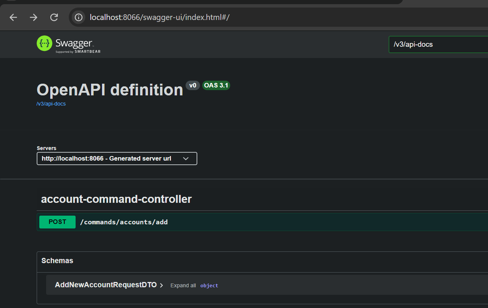
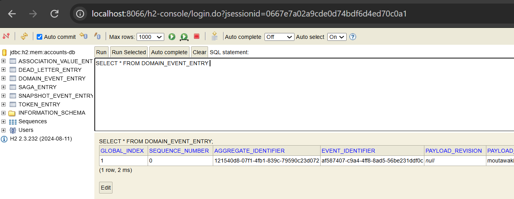
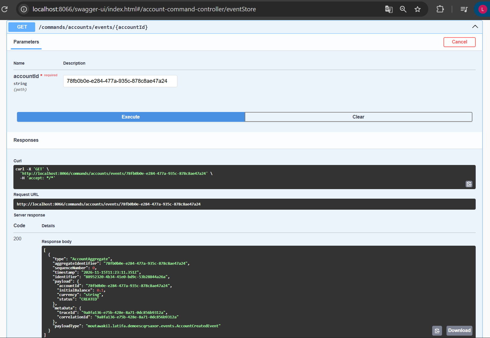
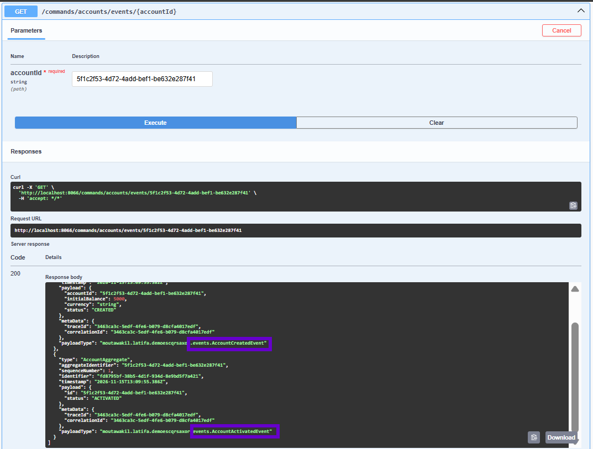
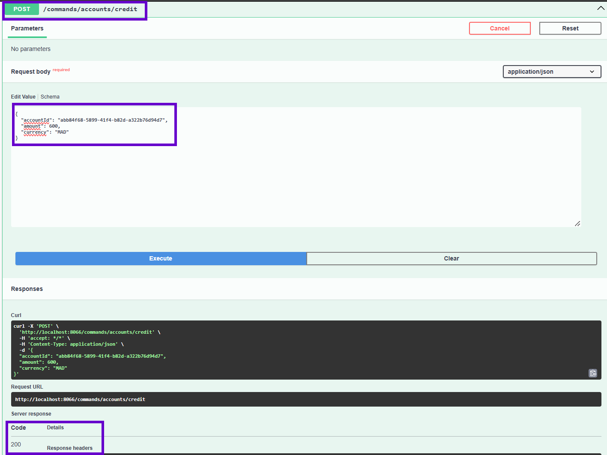
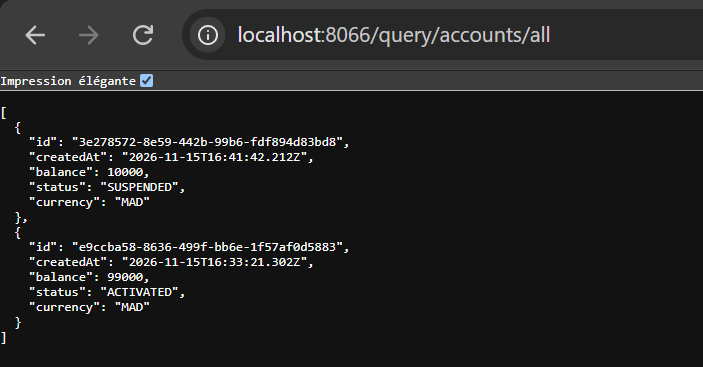
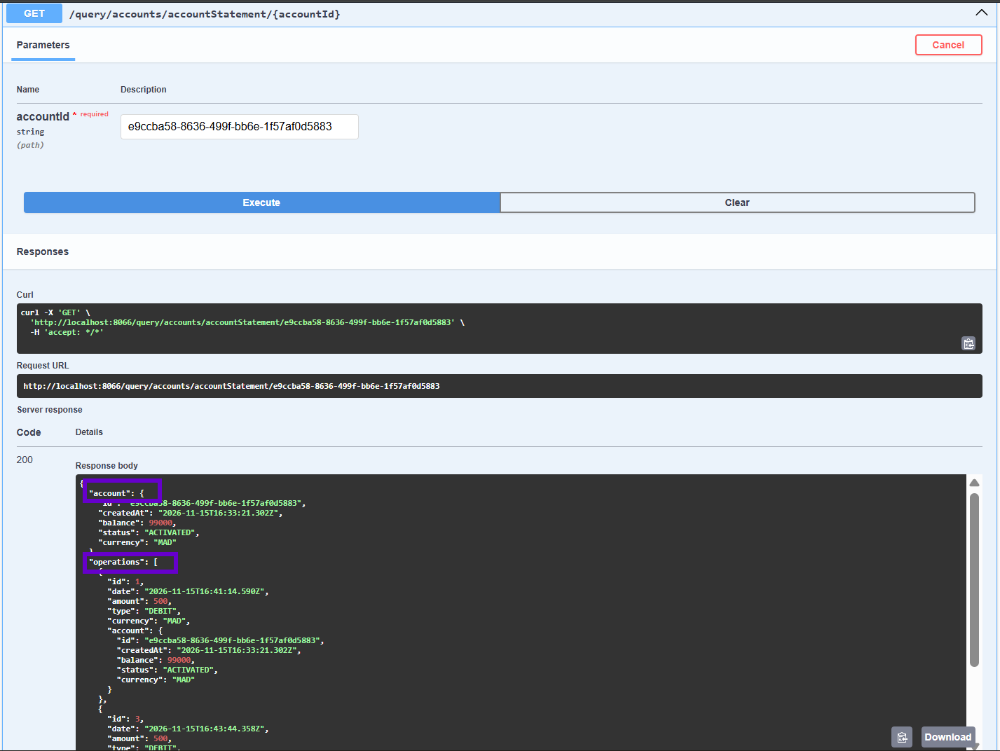

Swagger-methode post  /commands/accounts/add

h2-console table domain event entry

test data connection postgres es-accounts_db

test /commans/accounts/events/{accountsId} donne les donnes format json

2 events are created after creating an account test by swagger

Test credit method 

Test de la synchronization entre BDD decriture et lecture by "/query/accounts/all"

Test account statement by "/query/accounts/statement/{accountId}"
