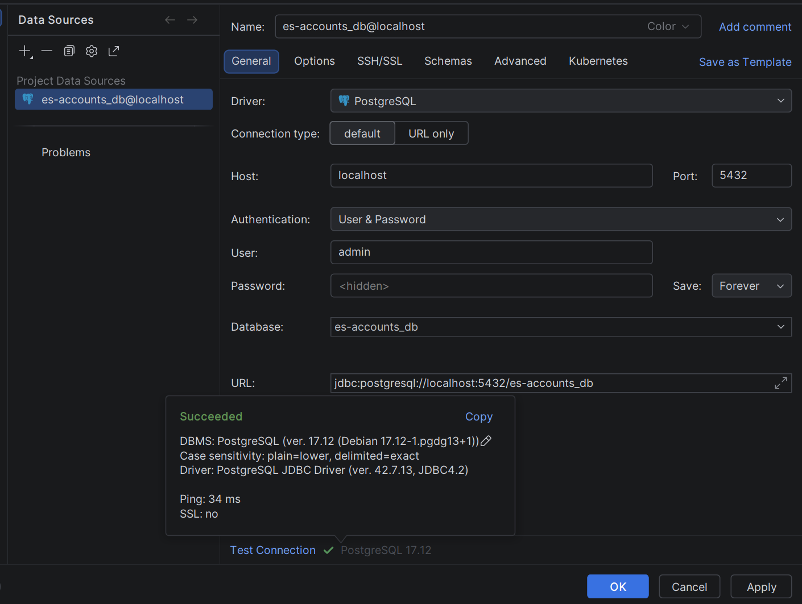
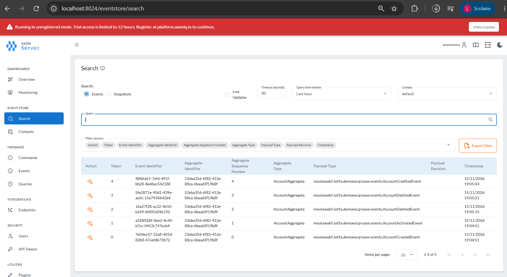

# Gestion de comptes bancaires avec Event Sourcing et CQRS (Axon Framework)

Application de gestion de comptes bancaires qui met en oeuvre les patterns **Event Sourcing** et **CQRS** avec **Spring Boot** et **Axon Framework**. Le projet sépare strictement le modèle d'écriture (commandes et event store) du modèle de lecture (base relationnelle alimentée par la projection des événements).

## Sommaire

1. [Fonctionnalités](#fonctionnalités)
2. [Stack technique](#stack-technique)
3. [Architecture](#architecture)
4. [Structure du projet](#structure-du-projet)
5. [Modèle de domaine](#modèle-de-domaine)
6. [API REST](#api-rest)
7. [Prérequis](#prérequis)
8. [Installation et exécution](#installation-et-exécution)
9. [Configuration](#configuration)
10. [Passage à Axon Server](#passage-à-axon-server)
11. [Tests et validation](#tests-et-validation)
12. [Points d'attention](#points-dattention)

## Fonctionnalités

- Création d'un compte avec activation automatique
- Crédit et débit d'un compte
- Changement de statut d'un compte (CREATED, ACTIVATED, SUSPENDED, CLOSED)
- Consultation de l'ensemble des comptes
- Consultation du relevé d'un compte (informations du compte et liste de ses opérations)
- Consultation des événements d'un agrégat depuis l'event store
- Suivi des opérations en temps réel (Server-Sent Events)
- Documentation interactive de l'API avec Swagger UI

## Stack technique

| Composant | Technologie |
|---|---|
| Langage | Java 21 |
| Framework | Spring Boot 3.5.7 (Web, Data JPA) |
| Event Sourcing et CQRS | Axon Framework 4.10.3 |
| Event store | JPA (PostgreSQL) ou Axon Server |
| Base de lecture | PostgreSQL |
| Documentation de l'API | springdoc-openapi 2.8.13 (Swagger UI) |
| Sérialisation des événements | Jackson (JSON) |
| Outils | Lombok, Docker Compose, pgAdmin |

## Architecture

Le fonctionnement repose sur le principe d'Event Sourcing : l'état d'un agrégat n'est jamais stocké directement, il est reconstruit à partir de la suite des événements qui le concernent.

```
                        COTE ECRITURE (Command)
 +--------+   REST   +--------------------+  CommandGateway  +----------------+
 | Client | -------> | Command Controller | ---------------> | Command Bus    |
 +--------+          +--------------------+                  +-------+--------+
                                                                     |
                                                                     v
                                                  +--------------------------------+
                                                  | AccountAggregate               |
                                                  |  Command Handler               |
                                                  |  (regles metier, decision)     |
                                                  |  Publication des evenements    |
                                                  |  Event Sourcing Handler        |
                                                  |  (mutation de l'etat)          |
                                                  +----------------+---------------+
                                                                   |
                                                                   v
                                                  +--------------------------------+
                                                  | Event Store                    |
                                                  | (JPA / Axon Server)            |
                                                  +----------------+---------------+
                                                                   |
                                                         Event Bus | (publication)
                                                                   v
                        COTE LECTURE (Query)
                                                  +--------------------------------+
                                                  | Event Handler                  |
                                                  | (projection des evenements)    |
                                                  +----------------+---------------+
                                                                   |
                                                                   v
 +--------+   REST   +--------------------+  QueryGateway   +------------------+
 | Client | <------- | Query Controller   | <-------------> | Query Handler    |
 +--------+          +--------------------+                 +--------+---------+
                                                                      |
                                                                      v
                                                          +----------------------+
                                                          | Base de lecture      |
                                                          | (account, operation) |
                                                          +----------------------+
```

### Déroulement d'une commande

1. Le client envoie une requête REST au contrôleur de commandes.
2. Le contrôleur construit une commande et la transmet au bus de commandes via le `CommandGateway`.
3. L'agrégat `AccountAggregate` reçoit la commande, vérifie les règles métier (fonction de décision) et publie un ou plusieurs événements.
4. Les événements sont enregistrés dans l'event store.
5. L'agrégat applique chaque événement pour faire évoluer son état (fonction d'évolution).
6. Les événements sont diffusés aux gestionnaires d'événements du côté lecture, qui les projettent dans la base relationnelle.

### Déroulement d'une requête

1. Le client interroge le contrôleur de requêtes.
2. Le contrôleur émet une requête sur le bus de requêtes via le `QueryGateway`.
3. Le gestionnaire de requêtes lit la base de lecture et retourne le résultat.

### Principes appliqués

- **Fonction de décision** : le gestionnaire de commandes de l'agrégat vérifie les règles métier avant de publier les événements.
- **Fonction d'évolution** : chaque gestionnaire d'événements de l'agrégat applique l'événement à son état. L'état est reconstruit en rejouant les événements.
- **Projection** : les gestionnaires d'événements du côté lecture transforment les événements en données relationnelles interrogeables.
- **Tracking Event Processor** : Axon mémorise la position du dernier événement traité dans la table `token_entry`. Au premier démarrage, les événements passés sont rejoués automatiquement vers la base de lecture.
- **Immutabilité** : commandes, événements, requêtes et DTO sont des objets immuables.

## Structure du projet

Le code est organisé en deux grandes parties, séparées par package.

**Partie écriture (`commands`)**

| Package | Contenu |
|---|---|
| `commands.aggregates` | Agrégat `AccountAggregate` |
| `commands.commands` | Commandes : ajout de compte, crédit, débit, mise à jour du statut |
| `commands.controllers` | Contrôleur REST des commandes |

**Éléments partagés**

| Package | Contenu |
|---|---|
| `events` | Événements : compte créé, compte activé, compte crédité, compte débité, statut mis à jour |
| `enums` | Énumérations `AccountStatus` et `OperationType` |
| `dto` | Objets de requête de l'API |

**Partie lecture (`query`)**

| Package | Contenu |
|---|---|
| `query.entities` | Entités JPA `Account` et `Operation` |
| `query.repository` | Repositories Spring Data |
| `query.handlers` | Gestionnaire d'événements (projection) et gestionnaire de requêtes |
| `query.queries` | Requêtes : liste des comptes, relevé de compte, suivi en temps réel |
| `query.controllers` | Contrôleur REST des requêtes |

La séparation en packages `commands` et `query` permet, si nécessaire, de scinder l'application en deux microservices distincts. Les événements, les énumérations et les objets partagés seraient alors extraits dans un module commun.

## Modèle de domaine

### Agrégat `AccountAggregate`

| Attribut | Description |
|---|---|
| `accountId` | Identifiant de l'agrégat |
| `balance` | Solde courant |
| `status` | Statut du compte |

### Statuts d'un compte

CREATED, ACTIVATED, SUSPENDED, CLOSED

### Commandes et événements

| Commande | Événement(s) produit(s) |
|---|---|
| Ajout de compte | Compte créé, puis compte activé |
| Crédit | Compte crédité |
| Débit | Compte débité |
| Mise à jour du statut | Statut du compte mis à jour |

### Règles métier

- **Création** : le solde initial ne peut pas être négatif. Le compte est automatiquement activé après sa création.
- **Crédit** : le compte doit être au statut ACTIVATED et le montant strictement positif.
- **Débit** : le compte doit être au statut ACTIVATED, le montant strictement positif et le solde suffisant.
- **Changement de statut** : le nouveau statut doit être différent du statut courant.

### Modèle de lecture

| Entité | Attributs |
|---|---|
| `Account` | Identifiant, solde, devise, statut, date de création |
| `Operation` | Identifiant, date, montant, devise, type (CREDIT ou DEBIT), compte associé |

## API REST

La documentation interactive est disponible dans Swagger UI, à l'adresse `http://localhost:8066/swagger-ui.html`.

### Côté commandes (écriture)

| Méthode | URL | Description |
|---|---|---|
| POST | `/commands/accounts/add` | Créer un compte (solde initial et devise) |
| POST | `/commands/accounts/credit` | Créditer un compte |
| POST | `/commands/accounts/debit` | Débiter un compte |
| PUT | `/commands/accounts/updateStatus` | Modifier le statut d'un compte |
| GET | `/commands/accounts/events/{accountId}` | Lister les événements d'un compte depuis l'event store |

La création d'un compte retourne l'identifiant du compte créé.

### Côté requêtes (lecture)

| Méthode | URL | Description |
|---|---|---|
| GET | `/query/accounts/all` | Lister tous les comptes |
| GET | `/query/accounts/statement/{accountId}` | Relevé d'un compte (compte et opérations) |
| GET | `/query/accounts/watch/{accountId}` | Flux d'opérations en temps réel (text/event-stream) |

Les URL exactes de chaque opération sont consultables dans Swagger UI.

## Prérequis

- JDK 21
- Maven 3.9 ou supérieur
- Docker et Docker Compose

## Installation et exécution

1. Cloner le dépôt et se placer à la racine du projet.
2. Démarrer l'infrastructure avec Docker Compose. Le fichier `docker-compose.yml` lance deux services : PostgreSQL (image 17, base `es-accounts_db`) et pgAdmin.
3. Lancer l'application avec Maven (goal `spring-boot:run`) ou depuis l'IDE. L'application démarre sur le port 8066.
4. Ouvrir Swagger UI pour tester les opérations.

### Services et accès

| Service | Adresse |
|---|---|
| Application et Swagger UI | http://localhost:8066/swagger-ui.html |
| PostgreSQL | localhost:5432 |
| pgAdmin | http://localhost:8088 |
| Console H2 (profil H2 uniquement) | http://localhost:8066/h2-console |
| Axon Server (dashboard) | http://localhost:8024 |

Dans pgAdmin, l'hôte à renseigner pour enregistrer le serveur PostgreSQL est le nom du service Docker (`postgres`), et non `localhost`.

## Configuration

### Paramètres principaux

| Paramètre | Valeur | Rôle |
|---|---|---|
| Nom de l'application | demo-es-cqrs-axor | Identifiant Spring |
| Port du serveur | 8066 | Port HTTP |
| Source de données | PostgreSQL, base `es-accounts_db` | Event store JPA et base de lecture |
| Mode DDL Hibernate | update | Création et mise à jour automatiques du schéma |
| Open in view | désactivé | Évite l'accès aux données pendant le rendu de la vue |
| Axon Server | désactivé | Utilisation de l'event store JPA |
| Sérialisation des événements | Jackson | Payload des événements stocké au format JSON |
| Sérialisation des messages | XStream | Messages Axon |
| Sérialisation générale | Jackson | Sérialisation des autres objets |

Les identifiants de connexion à la base de données sont à définir dans le fichier `application.properties`, en cohérence avec ceux du `docker-compose.yml`.

Pour un premier test sans Docker, une base H2 en mémoire peut remplacer PostgreSQL. Les données sont alors perdues à chaque redémarrage.

### Dépendance Axon

Le connecteur Axon Server est exclu de la dépendance `axon-spring-boot-starter` (version 4.10.3) afin d'utiliser l'event store JPA.

## Passage à Axon Server

L'event store JPA convient à une application monolithique. Pour une architecture distribuée, dans laquelle plusieurs microservices échangent des événements, Axon Server joue le rôle d'event store et de bus de messages (communication gRPC).

1. Supprimer l'exclusion du connecteur Axon Server dans le `pom.xml`.
2. Supprimer le paramètre qui désactive Axon Server.
3. Ajouter au `docker-compose.yml` un service basé sur l'image `axoniq/axonserver`, exposant les ports 8024 (dashboard) et 8124 (gRPC).
4. Redémarrer l'infrastructure puis l'application.

Les événements sont alors stockés dans Axon Server et consultables depuis son dashboard.

## Tests et validation

Les captures suivantes illustrent la validation de l'application.

### Création d'un compte depuis Swagger UI

Méthode POST sur `/commands/accounts/add`.


### Table des événements dans la console H2

Table `domain_event_entry` de l'event store.


### Connexion à la base PostgreSQL

Test de connexion à la base `es-accounts_db`.



### Consultation des événements d'un agrégat

Endpoint `/commands/accounts/events/{accountId}` : les événements sont retournés au format JSON.


### Événements générés à la création d'un compte

La création d'un compte produit deux événements : compte créé et compte activé.


### Test de l'opération de crédit


### Synchronisation entre la base d'écriture et la base de lecture

Vérification via l'endpoint `/query/accounts/all`.


### Relevé d'un compte

Endpoint `/query/accounts/statement/{accountId}`.


### Interface Axon Server

Dashboard Axon Server avec des exemples d'événements.



## Points d'attention

- **Compatibilité des versions** : Axon Framework 4.10.x est compatible avec Spring Boot 3.x. L'association avec Spring Boot 4 empêche l'auto-configuration de l'event store JPA et provoque l'erreur indiquant que la configuration par défaut requiert l'event sourcing.
- **Sérialisation Jackson** : les classes d'événements doivent disposer d'un constructeur sans argument et de getters pour être désérialisées correctement.
- **Identifiant de l'agrégat** : chaque commande doit déclarer son champ d'identité comme identifiant cible de l'agrégat, et l'agrégat doit déclarer son propre identifiant. Sans cela, Axon ne peut pas router la commande.
- **Fonction d'évolution** : chaque événement persisté doit disposer de son gestionnaire côté agrégat, faute de quoi l'état de l'agrégat n'est pas mis à jour.
- **Identifiant du compte côté lecture** : l'identifiant de l'entité `Account` provient de l'événement et ne doit pas être généré automatiquement.
- **Rejeu des événements** : pour reconstruire la base de lecture, supprimer les tables de lecture et la table `token_entry`, puis redémarrer l'application. Éviter le mode DDL `create` en dehors des tests, car il supprime les données à chaque démarrage.
- **Volume PostgreSQL** : à partir de PostgreSQL 18, l'emplacement de données attendu change. L'image PostgreSQL 17 est utilisée pour rester compatible avec le montage historique du volume.
